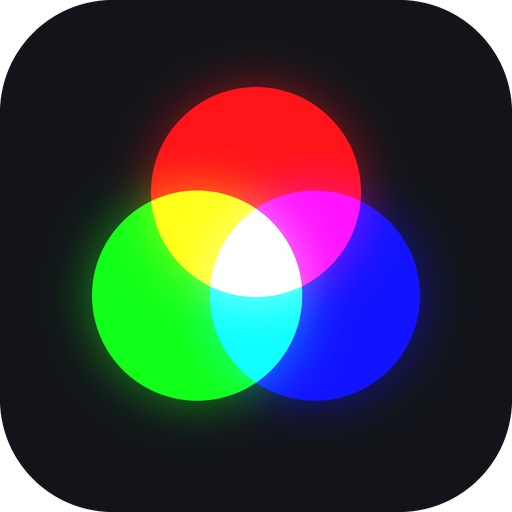

<div align="center">



# Lumea

**Desktop control for ELK-BLEDOM / MELK Bluetooth LED strips — drive multiple strips at once with a live color picker,
presets, effects and a system tray. Plugins add your PC's RGB, music mode and a phone remote.**


</div>

## Requirements

- Windows, or macOS on Apple Silicon
- Bluetooth turned on
- A strip advertising as `ELK-BLE`, `MELK`, or `ELK-BULB`
- *(optional, PC RGB)* an MSI board with a Mystic Light USB controller, a SteelSeries Apex 3 keyboard and/or a Rival 650
  mouse — driven by the MSI / SteelSeries plugins via `hidapi` (Windows only)

## Install

### macOS (Apple Silicon)

```bash
brew tap ugurcandede/tap
brew install --cask lumea
```

The cask clears Gatekeeper for you. To update later: `brew upgrade --cask lumea`.

### Windows

Download [`Lumea-windows.exe`](https://github.com/ugurcandede/lumea/releases/latest) and run it. On the SmartScreen prompt, choose **More info → Run anyway**.

### Run from source

Python 3.11 or later:

```bash
pip install -r requirements.txt
python main.py
```

> If `pip install` can't find a PySide6 wheel for the newest Python, use a 3.11–3.13 interpreter.

> **macOS, running from source:** Bluetooth access requires an `NSBluetoothAlwaysUsageDescription` entry in the
> *interpreter's* app bundle (the packaged app ships with it). Without it macOS terminates the process on the first
> scan, so Lumea refuses to scan and shows the one-time fix in its status line, e.g. for python.org's 3.13:
>
> ```bash
> plutil -insert NSBluetoothAlwaysUsageDescription -string "Lumea controls Bluetooth LED strips." \
>   /Library/Frameworks/Python.framework/Versions/3.13/Resources/Python.app/Contents/Info.plist
> ```

## Usage

1. **Scan** — lists nearby strips.
2. **Tick** the strips you want, then press **Connect**. Double-click a row to set an **alias**; the bin icon (or a
   right-click) forgets a saved strip.
3. Pick the target with the **Editing** chips — **All** ticked strips, or any you pick — then use the **color picker**
   (or type a hex colour), **brightness** and **power**; commands go to every connected target at once.
4. **Presets** — the 12 dots: left-click applies, right-click saves the current color.
5. **Disconnect** (the same button, once everything ticked is linked) drops every connection.
6. **Settings** (the icon in the title bar, or the tray menu): theme (auto / light / dark), tray icon colour, usage stats,
   updates, about, and **Manage plugins**.

Closing the window keeps the app in the **system tray**. Checked devices, aliases, presets and the last color are saved
and restored on launch, and dropped links auto-reconnect. After a minute without changes Lumea releases the Bluetooth
links, so idle strips don't compete with your headphones; the next command reconnects them (effects and music keep
them up).

## Features

- Control **multiple strips at once**
- Per-device **aliases**
- **Live color** picker with 12 savable **presets**
- **System tray** — runs in the background; quick colours, power and settings from the menu, icon can reflect the current color
- **Light / dark theme**, following the system or fixed
- Settings persistence and auto-reconnect
- **Updates itself** — the exe swaps in place on Windows, Homebrew on macOS
- **MSI motherboard RGB** *(Windows, plugin)* — a Mystic Light controller as a device in the list, driverless
- **SteelSeries RGB** *(Windows, plugin)* — an Apex 3 keyboard and/or Rival 650 mouse as devices in the list, driverless
- **Effects** — Rainbow, Breathe and Cycle on every device, with a speed control
- **Music mode** *(plugin)* — the lights follow whatever your PC is playing, on Windows and macOS 13+
- **Plugins** — optional add-ons, installed from Settings › Manage plugins, such as **Remote control** from your phone

## MSI motherboard RGB (plugin · Windows)

If your PC is an MSI board with a **Mystic Light** USB controller, Lumea can control its RGB too — no MSI Center, no kernel driver. Install **MSI Mystic Light** from Settings › Manage plugins: the controller appears in the device list as **MSI Mystic Light** (always "Connected"). Tick it to make it part of **All**, or click its row to edit it on its own — colour, brightness, power and effects, like a strip.

- **Driverless** — pure USB HID via [`hidapi`](https://pypi.org/project/hidapi/) (Windows only).
- **Static color only.** Lumea never sends firmware effect/mode bytes — those are undocumented and have bricked some boards. Writes are volatile, so a reboot restores your BIOS lighting. Lumea's own effects stream static colours, so they work on it too.
- **Case fans:** if they run off a case controller (e.g. MSI Gungnir), set that controller to **motherboard control** (JARGB) mode so they follow Lumea.
- Verified on an **MSI MPG Z790 CARBON WIFI**. Same-variant Mystic Light USB boards should work; anything else is detected and left untouched.

## SteelSeries RGB (plugin · Windows)

If a SteelSeries **Apex 3** keyboard or **Rival 650** mouse is plugged in, Lumea can drive its lighting too — no SteelSeries GG, no driver. Install **SteelSeries** from Settings › Manage plugins: each appears as its own device row (**SteelSeries Apex 3** / **SteelSeries Rival 650**, always "Connected"). Tick it to make it part of **All**, or click its row to edit it on its own.

- **Driverless** — pure USB HID via [`hidapi`](https://pypi.org/project/hidapi/), like the MSI plugin.
- **Static color only**, following the picker and Lumea's effects. No brick risk (plain HID output reports; nothing is written to onboard flash).
- Verified on an **Apex 3** and a **Rival 650**. Other SteelSeries models are detected and left alone.

## Effects

The **Effect** chips under Brightness animate every device the picker drives: **Rainbow** turns through the
colour wheel, starting from your colour, **Breathe** fades the picked colour in and out, **Cycle** glides through your
presets. **Speed** sets the pace. Only one effect or music mode runs at a time; Bluetooth strips get about 12 frames a
second.

## Music mode (plugin)

Install **Music mode** from Settings › Manage plugins: a **Music** row appears under Effect and makes the lights
follow the system audio — on Windows a WASAPI loopback via
[`PyAudioWPatch`](https://pypi.org/project/PyAudioWPatch/), on macOS 13+ ScreenCaptureKit's audio capture; no
microphone, no virtual audio driver. Commands go to the same targets as the picker.

- **macOS asks for Screen & System Audio Recording** the first time a mode starts; allow Lumea, then relaunch it.
  That is the only way macOS lets an app hear the system audio — there is no audio-only permission, and the
  microphone isn't part of it. Lumea reads the audio alone; the screen isn't looked at, recorded or sent anywhere.
  Running from source, the permission goes to whatever runs Python (your terminal or IDE).

- **Pulse** — the picked color, brightness following the music.
- **Spectrum** — bass drives red, mids green, treble blue.
- **Beat** — steps through your presets on every beat.
- **Flow** — the hue keeps turning, faster the louder the music.
- **Sensitivity** — how loud the music must be to light up fully. It doesn't adapt to the track: raise it for
  quiet tracks, lower it if everything sits at full.
- **Low / Mid / High** — turn a band down when it dominates (usually the bass). Spectrum's red, green and blue
  follow them.
- **Bluetooth strips may lag behind the music.** BLE only carries so many color updates a second, and fewer the more
  strips are connected; frames it can't keep up with are dropped. The USB devices (MSI, SteelSeries) follow closely.
- Listens to the default output device at the moment a mode starts; after switching speakers or headphones, pick the
  mode again.

## Plugins

Settings › **Manage plugins** lists optional add-ons; install one and switch it on. They update on their own, without a
new Lumea release (see [plugins/README.md](plugins/README.md) for how they work and how to
write one). **Random color** is the small example to start from.

**Remote control** drives Lumea from a phone, tablet or another computer's browser on the same network: colour,
brightness, presets, effects and music, the strips and devices, and the app's settings. Switch it on, then scan the
QR shown under it (or open the address and enter the 6-digit PIN; five wrong PINs lock the sender out for a minute).
Windows asks once to let Lumea through the firewall: allow it on private networks. If several PCs run it, the page
lists them and switches between them; each pairs on its own. **Reset pairings** draws a new PIN and forgets every
paired browser, and the port can be changed if something else uses it.

## Privacy

Once a day Lumea sends an anonymous ping to Google Analytics: a random install id and the app version. Nothing else —
**no device names, no addresses, no colors.** Turn it off any time by unchecking **Send anonymous usage stats** in
settings.

## Layout

```
main.py            entry point: QApplication + qasync event loop
ui.py              LedController: device list, editor, presets, effects, settings, system tray
ble.py             scan(); ElkBledom (one strip); DeviceManager (many strips, fan-out)
protocol.py        the strip's byte frames + scale_rgb (client-side brightness)
effects.py         Rainbow / Breathe / Cycle colour maths
colorpicker.py     embedded SV-square + hue-bar color picker
icon.py            app icon + dynamic tray icon
theme.py           light / dark palettes and the stylesheet
updates.py         self-update: exe swap on Windows, Homebrew on macOS
analytics.py       one anonymous daily ping (opt-out in Settings)
plugin_api.py      LumeaAPI, the one surface plugins use
plugin_host.py     downloads, loads and runs plugins
plugin_runtime.py  libraries bundled for plugins (hidapi, numpy, …)
plugins/           the plugins: msi, steelseries, music, remote-control, random_color (see plugins/README.md)
tools/plugins.py   maintains and checks plugins/version.json
docs/              the website (GitHub Pages): landing page, features, guide, FAQ, download
```

---

<p align="center">
   <a href="https://github.com/ugurcandede">
    
  </a>
</p>

<p align="center">
  <sub>Not affiliated with the makers of ELK-BLEDOM / MELK devices, or with MSI / Mystic Light or SteelSeries.</sub>
</p>
